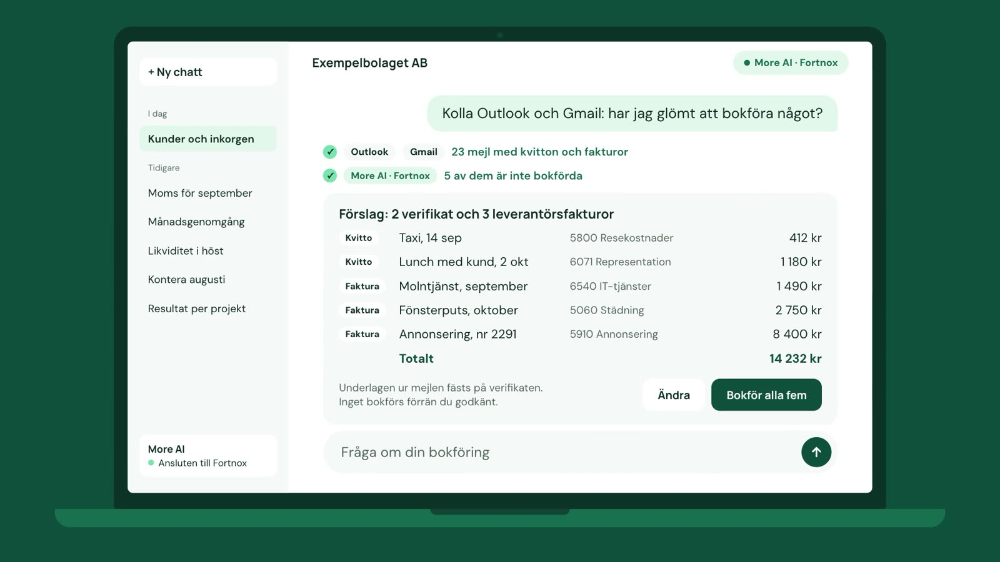
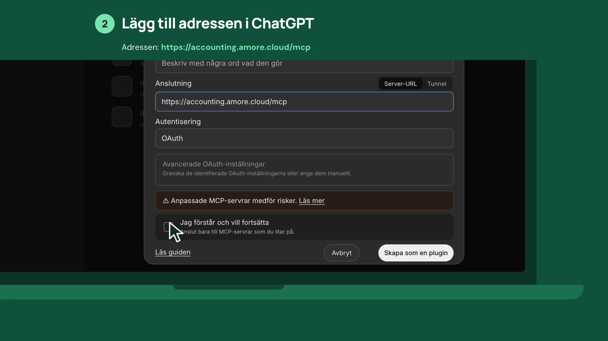
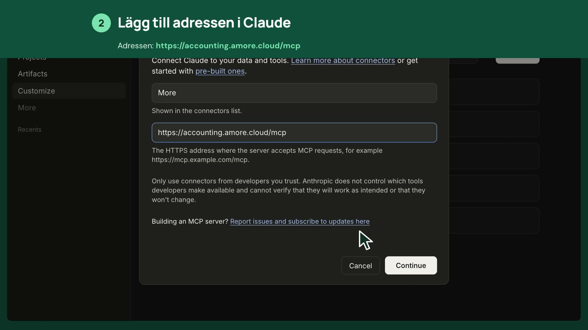

<p align="center"></p>

<h1 align="center">Fortnox MCP server — More AI</h1>

<p align="center">Connect <strong>ChatGPT</strong>, <strong>Claude</strong> and other MCP clients to <strong>Fortnox</strong>.<br>
Ask about your books in plain language, and approve every change before it is written.</p>

<p align="center">
<a href="https://accounting.amore.cloud/en/?k=github">Website</a> ·
<a href="https://accounting.amore.cloud/en/get-started/?k=github">Get started</a> ·
<a href="https://www.fortnox.se/integrationer/integration/starberg-more-solutions-ab/more-ai-chatgpt-claude-mcp">Fortnox App Market</a> ·
<a href="https://glama.ai/mcp/connectors/cloud.amore.accounting/fortnox">Glama</a> ·
<a href="#på-svenska">Svenska</a>
</p>

---

**More AI - ChatGPT & Claude MCP** is a hosted, remote [MCP](https://modelcontextprotocol.io) server for Fortnox, the Swedish accounting system. You add one address to your AI app, sign in with Fortnox, and the assistant can answer from your own bookkeeping.

```
https://accounting.amore.cloud/mcp
```

Streamable HTTP · OAuth sign-in through Fortnox · listed in the [official MCP Registry](https://registry.modelcontextprotocol.io) as `cloud.amore.accounting/fortnox`



## What you can ask

- *Which customers are late paying?* — open invoices and aging, per customer
- *Book the inbox* — supplier invoices read, matched to suppliers and coded, as one proposal to approve
- *Book this receipt* — a voucher proposed with account and VAT, the receipt attached
- *Which vouchers have no attachment?* — and what is still lying in the Fortnox inbox
- *Does the bank account match the books?* — balance reconciliation, also against camt.053 statements
- *How does cash look for the next six weeks?* — cash forecast from open invoices
- *Go through the last three months* — VAT rates, missing attachments and possible duplicates, each with a proposed fix

Reads cover invoices, supplier invoices, vouchers, accounts, reports, VAT, inventory and more. Changes — booking, registering, sending invoices and reminders — are always proposed first and sent only after you approve that exact content.

## Connect

1. **Buy and activate** More AI in the [Fortnox App Market](https://www.fortnox.se/integrationer/integration/starberg-more-solutions-ab/more-ai-chatgpt-claude-mcp). The first 30 days are free.
2. **Add the address** `https://accounting.amore.cloud/mcp` in your AI app:
   - **ChatGPT:** Plugins → Add → Create custom MCP server. [Step by step](https://accounting.amore.cloud/en/get-started/chatgpt/?k=github)
   - **Claude:** Customize → Connectors → Add custom connector. [Step by step](https://accounting.amore.cloud/en/get-started/claude/?k=github)
   - **Gemini CLI:** `gemini extensions install https://github.com/amor3/fortnox-mcp`, then `/mcp auth fortnox` inside Gemini CLI to sign in.
   - **Claude Code, Codex and other MCP clients:** add it as a remote HTTP server.
3. **Sign in with Fortnox**, choose the company, and choose *read* or *read & write*.

| ChatGPT | Claude |
|---|---|
|  |  |

## Videos

- [Four questions answered from Fortnox](https://youtu.be/0eDhPKpS9Sc) (34 s, Swedish, no sound)
- [Connect ChatGPT to Fortnox](https://youtu.be/0GvXdpIS67k) (39 s)
- [Connect Claude to Fortnox](https://youtu.be/S0IwiKPBmr0) (42 s)

## Security

- Signs in through Fortnox's own OAuth. We never see your Fortnox password.
- Every change is shown in full and sent only after you approve it. Changed payment details on a supplier require a fresh Fortnox sign-in to approve.
- Each company can be set to read-only.
- No copy of the books is stored. Reads are kept in working memory for at most three minutes.

More on the [security page](https://accounting.amore.cloud/en/security/?k=github).

## Price

119 SEK per company and month excluding VAT, billed by Fortnox. All users in the company are included. The first 30 days are free.

## On this repository

This repository describes the service and how to connect to it. The server itself is hosted and is not open source. Questions and problems: [support](https://accounting.amore.cloud/en/support/?k=github) or an issue here.

---

## På svenska

**More AI - ChatGPT & Claude MCP** kopplar ditt Fortnox till ChatGPT, Claude eller en annan AI-app som stöder MCP. Du frågar på vanlig svenska och får svar ur din egen bokföring. Assistenten kan också förbereda ändringar — bokföra ett kvitto, registrera leverantörsfakturor, skicka påminnelser — och ingenting skickas till Fortnox förrän du godkänt just det innehållet.

- **Adress:** `https://accounting.amore.cloud/mcp`
- **Pris:** 119 kr per bolag och månad exklusive moms, via Fortnox App Market. 30 dagar gratis.
- **Kom igång:** [accounting.amore.cloud/kom-igang/](https://accounting.amore.cloud/kom-igang/?k=github)
- **Guider:** [Bokför leverantörsfakturor med AI](https://accounting.amore.cloud/guider/bokfor-leverantorsfakturor-med-ai/?k=github) · [Bokför kvitton med AI](https://accounting.amore.cloud/guider/bokfor-kvitton-med-ai/?k=github) · [Matcha verifikationer med AI](https://accounting.amore.cloud/guider/matcha-verifikationer-med-ai/?k=github)

Drivs av Starberg & More Solutions AB.
